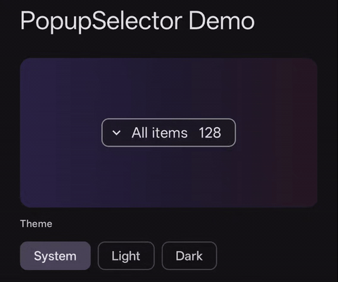

# PopupSelector

[](https://central.sonatype.com/)
[](https://opensource.org/licenses/Apache-2.0)
[](https://github.com/Viel0320/Popupselector)

A sleek, fluid morphing popup selector component for **Compose Multiplatform** (Android, JVM/Desktop, iOS).

---

## 🎬 Preview

<div align="center">
  
  <p>
    📦 <a href="Preview/PopupSelector%20Demo.apk"><b>Download Demo APK</b></a>
  </p>
</div>

---

## ✨ Features

- 🪶 **Zero External Dependencies**: Built exclusively on Compose Foundation and Material 3.
- 🪄 **Fluid Morphing Animation**: Seamless continuous transition between the collapsed button and the expanded floating surface.
- 🛫 **Flying Selected Item**: The selected item visibly flies from the trigger button into its position inside the expanded list.
- 🧭 **Smart Direction Resolution**: Each axis picks its side from the available space — centring on the current selection, hugging the leading edge, or pinning an explicit side (`Top`/`Bottom`, `Start`/`End`) via `PopupVerticalAlignment` / `PopupHorizontalAlignment`.
- ⌨️ **Keyboard Navigation**: Arrow keys move the cursor, `Enter`/`Space` select, `Esc` dismisses. Fully operable on desktop.
- 🎨 **Deep Customization**: Fully customizable colors, corner radius, heights, widths, and item slots.
- 🧩 **Pluggable Visual Effects**: Attach frosted-glass blur (Haze / Blur) or custom backgrounds via `anchorModifier` and `surfaceModifier`.
- 🧱 **Fully Overridable Metrics**: Every size, spacing and animation threshold is a plain data class you can replace wholesale.

---

## 📦 Installation

In your module's `build.gradle.kts` (e.g., `commonMain`):

```kotlin
kotlin {
    sourceSets {
        commonMain.dependencies {
            implementation("com.github.Viel0320.Popupselector:popupselector:2.0.1")
        }
    }
}
```

> [!NOTE]
> Ensure `mavenCentral()` is declared in your root `settings.gradle.kts` repositories block.

> [!NOTE]
> Material 3 is not exposed transitively at compile time. The library reads your
> `MaterialTheme` for its default colors, but if your module uses Material 3 APIs itself
> (as most Compose apps do), declare the `compose.material3` dependency explicitly.

For maintainers, see [PUBLISHING.md](PUBLISHING.md) for CI/CD release workflow and publishing instructions.

---

## 🚀 Usage Guide

### 1. Basic Text Selector with Count Badges

```kotlin
import androidx.compose.runtime.*
import com.viel.compose.popupselector.*

@Composable
fun FilterSelector() {
    var expanded by remember { mutableStateOf(false) }
    var selectedIndex by remember { mutableStateOf<Int?>(0) }

    val items = remember {
        listOf(
            textPopupItem(key = "all", label = "All Items", count = 128),
            textPopupItem(key = "favorites", label = "Favorites", count = 12),
            textPopupItem(key = "archived", label = "Archived", count = 3),
            textPopupItem(key = "trash", label = "Trash", enabled = false),
        )
    }

    PopupSelector(
        items = items,
        expanded = expanded,
        selectedIndex = selectedIndex,
        onExpandedChange = { expanded = it },
        onSelect = { selectedIndex = it },
        layout = PopupLayout(width = PopupWidth.Wrap),
    )
}
```

---

### 2. Custom Item Layout

You can provide fully customized item composables for each option:

```kotlin
val items = remember {
    listOf(
        PopupItem(
            key = "daily",
            count = { Text("7:00 AM", style = MaterialTheme.typography.bodySmall) },
        ) {
            Row(verticalAlignment = Alignment.CenterVertically) {
                Icon(Icons.Default.Today, contentDescription = null)
                Spacer(Modifier.width(8.dp))
                Text("Daily Digest")
            }
        },
        PopupItem(key = "weekly") {
            Row(verticalAlignment = Alignment.CenterVertically) {
                Icon(Icons.Default.DateRange, contentDescription = null)
                Spacer(Modifier.width(8.dp))
                Text("Weekly Summary")
            }
        },
    )
}

PopupSelector(
    items = items,
    expanded = expanded,
    selectedIndex = selectedIndex,
    onExpandedChange = { expanded = it },
    onSelect = { selectedIndex = it },
    layout = PopupLayout(width = PopupWidth.Fixed(280.dp)),
)
```

---

### 3. Width Strategies (`PopupWidth`)

Set via `PopupLayout(width = ...)`. Three strategies are available:


| Strategy                  | Description                                                                                                                           |
| :-------------------------- | :-------------------------------------------------------------------------------------------------------------------------------------- |
| `PopupWidth.Wrap`         | *(Default)* Fits the natural intrinsic width of the widest row item (constrained by screen margins), never narrower than the trigger. |
| `PopupWidth.MatchAnchor`  | Expands to the exact measured width of the collapsed trigger button.                                                                  |
| `PopupWidth.Fixed(width)` | Uses an explicit fixed width (e.g.`PopupWidth.Fixed(260.dp)`).                                                                        |

> [!NOTE]
> With `MatchAnchor` or a narrow `Fixed` width, overflowing labels marquee-scroll, but the
> trailing count slot is laid out at its shared section width and can be clipped if the panel is
> narrower than the content and count sections combined. Prefer `PopupWidth.Wrap` when items
> carry counts.

---

### 4. Expansion Origin (Popup Alignments)

Set via `PopupLayout(verticalAlignment = ..., horizontalAlignment = ...)`. The two axes resolve
independently, so the panel can, say, open downward while hugging the trailing edge.

**Vertical** — `PopupVerticalAlignment`:

- `Auto`: *(Default)* With a selection, aligns the selected row's vertical centre with the trigger's centre, so the current selection stays put as the panel opens. Without a selection, compares the room above and below and picks the side that fits.
- `Top` / `Bottom`: Pin the panel to that side of the trigger.

**Horizontal** — `PopupHorizontalAlignment`:

- `Auto`: *(Default)* Hugs the trigger's leading side when both sides fit; opens toward the only side with room. Mirrors with the layout direction.
- `Start` / `End`: Pin a direction-aware side (mirrors in RTL).

Both axes also offer `Inherit`, which follows the matching component of `LocalPopupAlignment` —
the ambient alignment a subtree provides with `CompositionLocalProvider` (typically alongside a
`Box(contentAlignment = ...)`), falling back to `Auto` when none is provided.

Explicit placements are honoured whether or not an item is selected. Only `Auto` repositions the
panel vertically to match the selection.

---

### 5. Custom Collapsed Trigger Button (Menu Mode)

You can customize the content inside the collapsed button (ideal for dropdown action menus).
`collapsedContent` is the last parameter, so it can be passed as a trailing lambda:

```kotlin
PopupSelector(
    items = menuItems,
    expanded = expanded,
    onExpandedChange = { expanded = it },
    onSelect = { index -> handleMenuAction(index) },
) {
    Text("Actions Menu", fontWeight = FontWeight.Bold)
}
```

---

### 6. Frosted Glass / Background Blur (Optional)

To use real-time blur libraries like [Haze](https://github.com/chrisbanes/haze), wrap your root layout in `PopupOverlayContainer` (or `PopupOverlayHost`) so the panel shares the same window and drawing tree with `hazeSource` (isolated native `Popup` windows cannot sample parent pixels). Combine with `PopupDefaults.blurColors()` for preconfigured transparent surfaces.

> [!IMPORTANT]
> **Dual-State Background Sampling Setup (Avoiding Color Flickering / Flashing)**
>
> During morph animations, the selector smoothly transitions from the collapsed trigger to the expanded panel:
>
> - **Collapsed State**: Provide a background sampling source (`hazeSource`) beneath the anchor button and pass `anchorModifier = Modifier.hazeEffect(...)`. Note that the button must be layered *on top of* the background layer (not as a child inside the `hazeSource` composable) so Haze can sample behind it.
> - **Expanded State**: Provide a broader page/screen-level background sampling source (`hazeSource`) so the floating panel can sample correctly even when expanding outside local cards, using `surfaceModifier = Modifier.hazeEffect(...)`.
>
> Setting up sampling sources for both layers ensures seamless color and blur interpolation during the morph transition without visual glitches or color flashing.

```kotlin
val rootHazeState = remember { HazeState() }
val parentHazeState = remember { HazeState() }

// Wrap your root/screen in PopupOverlayContainer to enable seamless in-window blur sampling
PopupOverlayContainer(Modifier.fillMaxSize()) {
    // 1. Root layer registered as hazeSource (for expanded panel & full-screen blur)
    Column(
        modifier = Modifier
            .fillMaxSize()
            .hazeSource(rootHazeState)
            .padding(16.dp)
    ) {
        // 2. Direct parent container with background registered as hazeSource (for collapsed anchor button)
        Box(
            modifier = Modifier
                .background(Color.Blue.copy(alpha = 0.3f), RoundedCornerShape(12.dp))
                .hazeSource(parentHazeState)
                .padding(16.dp)
        ) {
            PopupSelector(
                items = items,
                expanded = expanded,
                selectedIndex = selectedIndex,
                onExpandedChange = { expanded = it },
                onSelect = { selectedIndex = it },
                style = PopupDefaults.style(colors = PopupDefaults.blurColors()),
                anchorModifier = Modifier.hazeEffect(state = parentHazeState, style = HazeMaterials.ultraThin()),
                surfaceModifier = Modifier.hazeEffect(state = rootHazeState, style = HazeMaterials.ultraThin()),
            )
        }
    }
}
```

---

## 🛠️ API Reference

### `PopupSelector` Parameters


| Parameter          | Type                                 | Default                 | Description                                                                                              |
| :------------------- | :------------------------------------- | :------------------------ | :--------------------------------------------------------------------------------------------------------- |
| `items`            | `List<PopupItem>`                    | *(Required)*            | List of options to display in the selector.                                                              |
| `expanded`         | `Boolean`                            | *(Required)*            | Whether the floating panel is currently expanded.                                                        |
| `onExpandedChange` | `(Boolean) -> Unit`                  | *(Required)*            | Callback when the expansion state changes.                                                               |
| `onSelect`         | `(index: Int) -> Unit`               | *(Required)*            | Callback invoked when an item is selected.                                                               |
| `modifier`         | `Modifier`                           | `Modifier`              | Modifier applied to the outer layout container.                                                          |
| `selectedIndex`    | `Int?`                               | `null`                  | Index of the currently selected option.                                                                  |
| `style`            | `PopupStyle`                         | `PopupDefaults.style()` | Visual configuration: metrics, timing, colours, typography, animation.                                   |
| `layout`           | `PopupLayout`                        | `PopupLayout()`         | Layout configuration: width, max height, alignment, host.                                                |
| `anchorModifier`   | `Modifier`                           | `Modifier`              | Modifier applied to the resting collapsed button surface.                                                |
| `surfaceModifier`  | `Modifier`                           | `Modifier`              | Modifier applied to the expanding floating surface.                                                      |
| `collapsedContent` | `(@Composable RowScope.() -> Unit)?` | `null`                  | Custom composable slot for the collapsed trigger button. Last, so it can be passed as a trailing lambda. |

### `PopupLayout`


| Field                 | Type                       | Default                     | Description                                                                                                          |
| :---------------------- | :--------------------------- | :---------------------------- | :--------------------------------------------------------------------------------------------------------------------- |
| `width`               | `PopupWidth`               | `PopupWidth.Wrap`           | Panel width strategy:`Wrap`,`MatchAnchor`,  or `Fixed(width)`.                                                      |
| `maxHeight`           | `Dp`                       | `Dp.Unspecified`            | Maximum panel height. Unspecified uses 60% of the window height.                                                     |
| `verticalAlignment`   | `PopupVerticalAlignment`   | `Auto`                      | Vertical placement:`Auto`, `Top`, `Bottom`, `Inherit`. See [Expansion Origin](#4-expansion-origin-popup-alignments). |
| `horizontalAlignment` | `PopupHorizontalAlignment` | `Auto`                      | Horizontal placement:`Auto`, `Start`, `End`, `Inherit`.                                                              |
| `host`                | `PopupHostPolicy`          | `PopupHostPolicy.Overlay()` | Where the panel is hosted:`Window` or `Overlay(state?)`.                                                             |

### `PopupStyle`


| Field               | Type                           | Default                                    | Description                                                 |
| :-------------------- | :------------------------------- | :------------------------------------------- | :------------------------------------------------------------ |
| `colors`            | `PopupColors`                  | *(Required)* — `PopupDefaults.colors()`   | Collapsed/expanded containers, border, content.             |
| `metrics`           | `PopupMetrics`                 | `PopupMetrics.Default`                     | Sizes, spacing, corner radius, elevations.                  |
| `timing`            | `PopupTiming`                  | `PopupTiming()`                            | Morph thresholds and stagger constants.                     |
| `textStyle`         | `TextStyle?`                   | `null`                                     | Typography for labels. Defaults to ambient`LocalTextStyle`. |
| `animationSpec`     | `AnimationSpec<Float>`         | spring (damping 0.9, medium-low stiffness) | Main morph and reveal animation spec.                       |
| `sizeAnimationSpec` | `FiniteAnimationSpec<IntSize>` | spring (damping 0.9, medium-low stiffness) | Size change animation spec for the collapsed anchor.        |
| `autoMarquee`       | `Boolean`                      | `true`                                     | Whether overflowing rows scroll with a marquee.             |

### `PopupMetrics`

All values are `@Stable` data class fields, so you can override any subset:

`collapsedHeight` (32.dp) · `collapsedTouchTarget` (48.dp) · `rowTouchTargetHeight` (48.dp) ·
`rowVerticalSpacing` (4.dp) · `panelVerticalPadding` (8.dp) · `collapsedHorizontalPadding` (16.dp) ·
`rowHorizontalPadding` (12.dp) · `chevronLeadingPadding` (8.dp) · `countSpacing` (12.dp) ·
`borderWidth` (1.dp) · `chevronSize` (18.dp) · `rowEnterTranslation` (14.dp) · `edgeMargin` (8.dp) ·
`maxHeightFraction` (0.6f) · `disabledAlpha` (0.38f) · `corner` (8.dp) · `collapsedElevation` (0.dp) ·
`expandedElevation` (6.dp)

### `PopupTiming`

`visibleEpsilon` (0.0001f) · `morphCompleteThreshold` (0.999f) · `chevronExpandFadeSpan` (0.25f) ·
`chevronCollapseFadeSpan` (0.25f) · `staggerBase` (0.15f) · `staggerStep` (0.06f) ·
`staggerMax` (0.6f) · `borderMinWidth` (0.25f) · `containerMinAlpha` (0.001f) ·
`shadowStartFraction` (0.85f) · `anchorHighlightFadeMillis` (90 ms)

`shadowStartFraction` delays the expanding surface's shadow until the morph is that far along, so a
low-elevation shadow doesn't read as a dark rim around transparent containers — set `0f` for an
always-on ramp. `anchorHighlightFadeMillis` is the collapsed trigger's press/hover highlight fade
duration.

### `PopupItem`


| Field     | Type                                 | Default | Description                                 |
| :---------- | :------------------------------------- | :-------- | :-------------------------------------------- |
| `key`     | `Any?`                               | `null`  | Stable identity for the option.             |
| `enabled` | `Boolean`                            | `true`  | Whether the option can be selected.         |
| `count`   | `(@Composable RowScope.() -> Unit)?` | `null`  | Optional trailing slot, e.g. a count badge. |
| `content` | `@Composable RowScope.() -> Unit`    | —      | Primary row content.                        |

---

### Keyboard & Accessibility

The expanded panel takes focus automatically and supports:


| Key               | Action                                      |
| :------------------ | :-------------------------------------------- |
| `↓` / `Tab`      | Move the cursor to the next enabled option. |
| `↑`              | Move the cursor to the previous option.     |
| `Enter` / `Space` | Select the focused option and dismiss.      |
| `Esc`             | Dismiss without changing the selection.     |

Disabled options are skipped by arrow-key navigation. While the panel collapses, its rows leave
the accessibility tree, and the surface unmounts entirely once collapsed, so the fading panel is
never announced. The collapsed trigger announces its expansion state via `stateDescription`
("Expanded" / "Collapsed"); Compose currently has no localizable expanded-state semantic property,
so these strings are supplied by the library in English.

---

## ⚡ Performance Note (Debug vs. Release)

> [!TIP]
> **Animation & State Handoff in Debug Builds**
>
> Due to Compose runtime overhead and unoptimized recompositions in **Debug** builds, the 1-frame transition/handoff interval between the collapsed anchor and the morphing surface may occasionally be amplified.
>
> In **Release** builds (with R8 / compiler optimizations enabled), this handoff is seamless and transitions run smoothly at full frame rate. Always evaluate animation fluidity on Release builds.

---

## 📄 License

```
Copyright 2026 Viel

Licensed under the Apache License, Version 2.0 (the "License");
you may not use this file except in compliance with the License.
You may obtain a copy of the License at

    http://www.apache.org/licenses/LICENSE-2.0

Unless required by applicable law or agreed to in writing, software
distributed under the License is distributed on an "AS IS" BASIS,
WITHOUT WARRANTIES OR CONDITIONS OF ANY KIND, either express or implied.
See the License for the specific language governing permissions and
limitations under the License.
```
